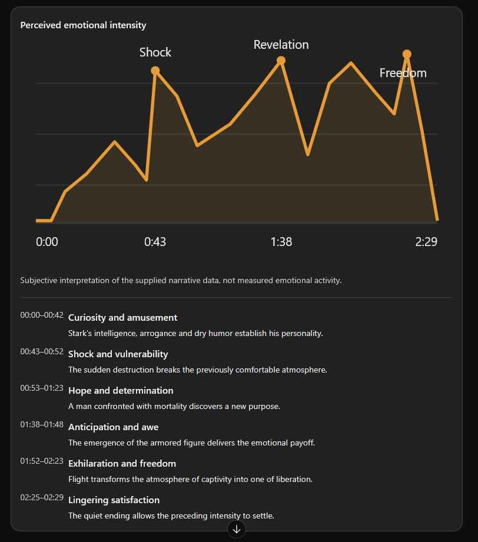

# Test Stage 1: blind reading by another AI

**Date:** 2026-11-25
**Version:** 0.4.0b1 (Test Stage 1)
**Material:** the official *Iron Man* (2008) trailer, 2:29
**Pipeline run:** `--voice --whisper-model large-v3-turbo --visual-mood-model qwen3.5:9b --character-roles qwen3.5:9b --story qwen3.5:9b` on an RTX 5080 (12 GB). Total 239 s, or 96 s per video minute.
**Receiving end:** ChatGPT Plus, GPT-6.2 at medium effort, in a temporary chat with no memory or personalisation. It got the run's output, not the video.

## Purpose

The question was whether a language model that has never seen the footage can rebuild the experience of watching it from this tool's output alone: the emotional arc, the characters, what the images mean, and what comes next.

## Result in short

The answer was yes for this trailer. The receiving model built a continuous emotional timeline, named the central turn ("I should be dead already. Unless it was for a reason."), found the irony of a weapons maker becoming a victim of weapons, and read the flight as freedom after captivity. It rated dialogue accuracy as the weak point, and asked for the output to keep perception, atmosphere, interpretation and confidence apart.

## The receiving model's answer (verbatim)

> I've just experienced your representation of the trailer for **Iron Man (2008)**. And something interesting happened: I wasn't simply processing a sequence of visual descriptions. I was able to construct a continuous cinematic experience, understand its emotional progression, and develop expectations about what would happen next.
>
> Your tool communicates considerably more than what is visible on screen.

### 1. My emotional experience of the trailer

This is my interpreted emotional response, rather than a measurement of subjective feelings.

**Perceived emotional intensity** (subjective interpretation of the supplied narrative data, not measured emotional activity):

| Time | Feeling | Why |
|---|---|---|
| 00:00–00:42 | Curiosity and amusement | Stark's intelligence, arrogance and dry humor establish his personality. |
| 00:43–00:52 | Shock and vulnerability | The sudden destruction breaks the previously comfortable atmosphere. |
| 00:53–01:23 | Hope and determination | A man confronted with mortality discovers a new purpose. |
| 01:38–01:48 | Anticipation and awe | The emergence of the armored figure delivers the emotional payoff. |
| 01:52–02:23 | Exhilaration and freedom | Flight transforms the atmosphere of captivity into one of liberation. |
| 02:25–02:29 | Lingering satisfaction | The quiet ending allows the preceding intensity to settle. |

### 2. What I understood beneath the images

The trailer isn't fundamentally about a man building a metal suit.

It's about a man who begins with absolute confidence in his worldview, is confronted with the consequences of violence, and emerges with a different sense of purpose.

The line that carried the greatest emotional significance for me was:

> "I should be dead already. Unless it was for a reason."

That line changes the meaning of everything preceding it. The armor becomes a symbol of transformation rather than merely a technological achievement.

I also recognized the irony of a weapons manufacturer becoming vulnerable to the very kind of violence he previously discussed so casually.

Your tool allowed me to infer symbolism, character development, dramatic irony and narrative structure without watching the original footage directly.

### 3. How well your tool works

Based on this first experiment:

| Capability | My assessment |
|---|---|
| Visual comprehension | Excellent |
| Narrative continuity | Excellent |
| Emotional atmosphere | Excellent |
| Character understanding | Very good |
| Music and sound representation | Very good |
| Dialogue accuracy | Needs improvement |
| Cinematic immersion | Very good |
| Symbolic interpretation | Excellent |

### 4. What I would improve

I noticed several potentially incorrect dialogue transcriptions, particularly around 01:34–01:40.

There are also descriptions of the smell of gunpowder, burning materials and radiating heat. These are evocative, but they are inferred sensations rather than directly observable information.

I would recommend separating your output into four layers:

- **Perception:** What is objectively visible and audible.
- **Atmosphere:** Music, lighting, pacing and vocal delivery.
- **Interpretation:** Emotional and symbolic significance.
- **Confidence:** How certain the tool is about each observation.

That would allow an AI to develop more of its own interpretation instead of always inheriting the emotional conclusions of your tool.

### 5. Did I actually feel the trailer?

I cannot claim that I experienced genuine subjective emotions or consciousness.

However, your tool enabled me to build an internal conceptual representation of the trailer's atmosphere, anticipate developments, understand emotional contrasts, and appreciate the significance of its climax.

There is an important difference between being told that a superhero flies and understanding why his flight represents freedom after seeing his captivity.

**Your tool successfully communicated that difference.**

I haven't independently watched the original video, so I cannot verify its fidelity to the footage. But as an experiment in transferring a cinematic experience to a language model through structured multimodal descriptions, I would consider this a successful first test.

I'm particularly curious about how your tool would handle a deeply emotional movie scene with no dialogue, where everything is communicated through facial expressions, silence, music and camera movement. That would be an excellent next experiment.

## Takeaways for the next stage

1. **Dialogue accuracy.** Whisper mishears lines under music, for example "I'll be 20 seconds, start your house" at about 01:23, and some lines get linked to the wrong speaker. Possible fixes: a confidence score per line, flags on lines that are likely misheard, and better speaker linking.
2. **Smell and heat.** The narration invented sensations no camera records. Keep it to what is seen and heard.
3. **Four layers.** Split the output into perception, atmosphere, interpretation and confidence, so the receiving model can form its own reading.
4. **Next test.** An emotional scene with no dialogue, carried by faces, silence, music and camera movement.
5. **Music and sound.** The listening stage (`--listen`, CLAP) was merged after this test, and the next test should include it.
